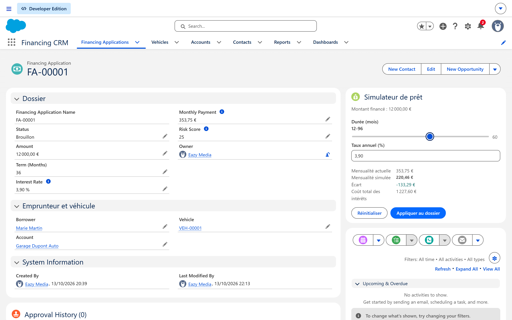
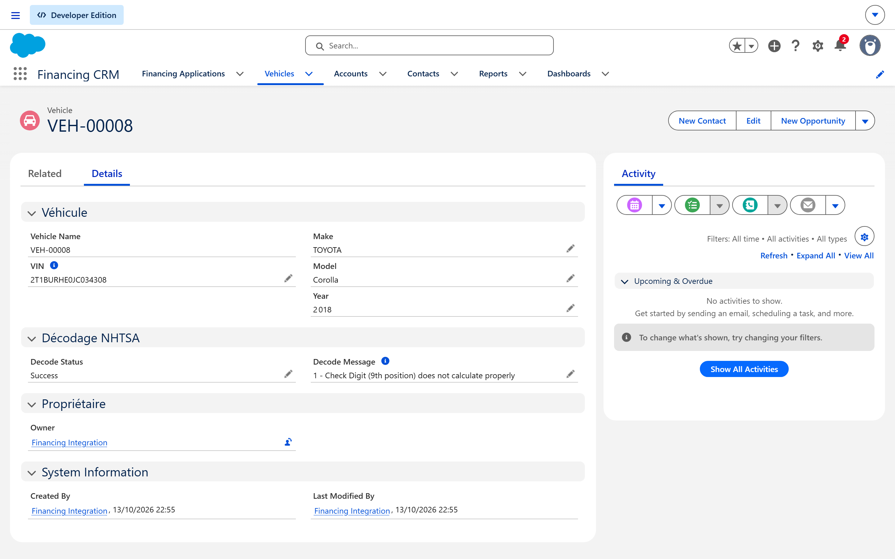
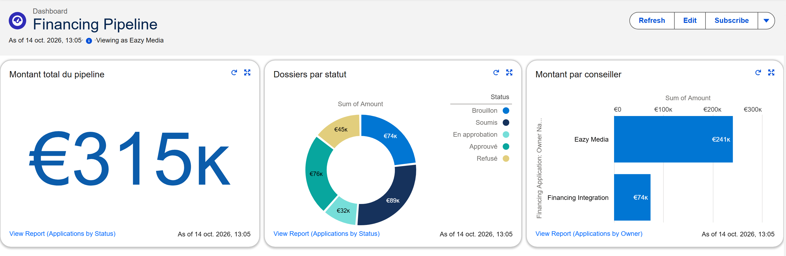
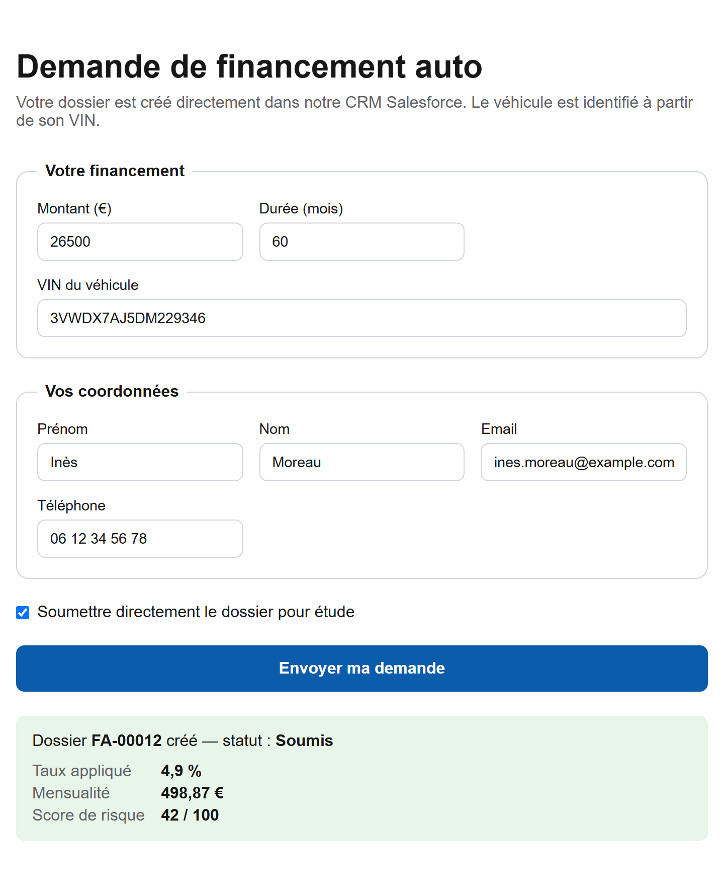
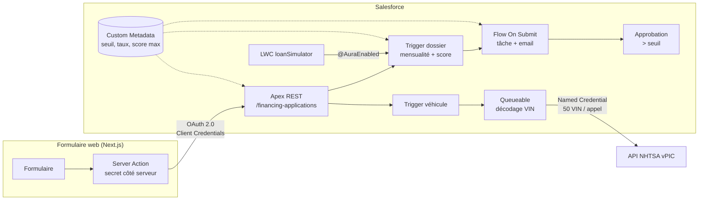
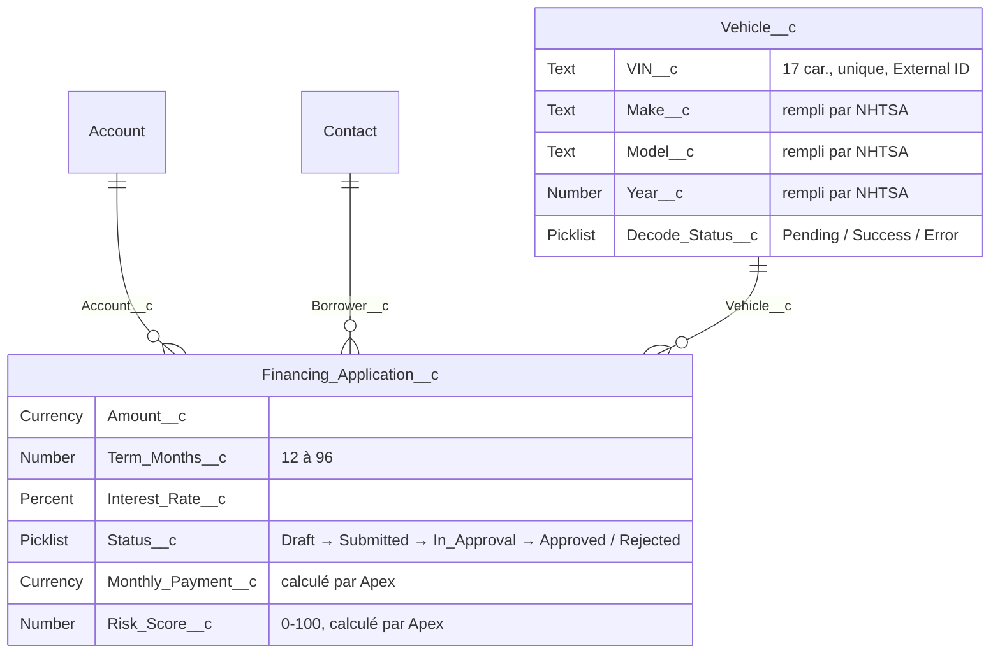

# Financing CRM — mini-CRM de financement auto sur Salesforce


Projet portfolio qui couvre le spectre d'un développeur Salesforce : **modèle de données, automatisation déclarative, Apex bulkifié et testé, intégrations REST entrante et sortante, LWC et CI/CD**.

Un conseiller gère des dossiers de financement auto. Un client peut déposer une demande depuis un formulaire web externe. Le véhicule est identifié automatiquement à partir de son VIN grâce à l'API publique de la NHTSA. La mensualité et un score de risque sont calculés côté serveur, et les gros montants partent en approbation.

|                  |                                                                                                                 |
| ---------------- | --------------------------------------------------------------------------------------------------------------- |
| Tests Apex       | **34**, couverture **97 %**, dont un test en lot de 200 enregistrements avec un utilisateur aux droits minimaux |
| Tests LWC (Jest) | **13**                                                                                                          |
| Pipeline         | GitHub Actions : lint + Jest + build du formulaire + validation/déploiement Salesforce avec tests               |

### Fiche dossier : simulateur de prêt (LWC) à droite



### Fiche véhicule : VIN décodé automatiquement par l'API NHTSA



### Dashboard du pipeline



### Formulaire web externe (Next.js → API REST Apex)



---

## Architecture



## Modèle de données



Les **lookups** (et non des master-detail) permettent à un véhicule d'avoir plusieurs dossiers dans le temps, et à un dossier d'exister avant d'être rattaché à un compte.

---

## Fonctionnalités et choix techniques

### Déclaratif

- **Règles de validation** : montant positif, durée de 12 à 96 mois, taux ≥ 0, VIN au bon format (`REGEX`, sans I, O ni Q).
- **Record-triggered Flow** : au passage à « Soumis », il crée une tâche de revue et envoie un email. Un _fault path_ évite qu'un échec d'email annule l'enregistrement.
- **Approval Process** au-delà d'un seuil. Les critères d'entrée d'une approbation ne savent pas lire le Custom Metadata : c'est donc le Flow qui lit le seuil et soumet le dossier.
- **Custom Metadata** `Financing_Setting__mdt` : seuil d'approbation, taux par défaut, score maximum. Aucune valeur métier n'est codée en dur.
- **Rapports et dashboard** du pipeline.

### Apex

- Un **trigger par objet, sans logique**, qui délègue à un handler.
- **Bulkification** : aucune requête SOQL ni DML dans une boucle. Le test sur 200 enregistrements vérifie que le trigger consomme **0 requête SOQL** (le Custom Metadata est lu via `getInstance()`).
- La **mensualité** est calculée par `LoanCalculator` (prêt amortissable, cas du taux nul, arrondi en `HALF_UP`), et le **score de risque** par `RiskScoreCalculator`.
- **Sécurité** : `with sharing`, `WITH USER_MODE` et `insert as user`. Les tests passent par un utilisateur qui n'a que le permission set.

### Intégration sortante : décodage du VIN

- **Named Credential** + **External Credential**. L'API NHTSA est publique, mais le protocole `NoAuthentication` est refusé au déploiement : la solution est le protocole `Custom`, sans aucun secret.
- **Un seul Queueable par transaction**, qui utilise l'endpoint `DecodeVINValuesBatch` (50 VIN par appel). Au-delà de 50, le job s'enchaîne.
- **Garde anti-boucle** : seul un changement de VIN relance un décodage.
- **Erreurs tracées** sur l'enregistrement (`Decode_Status__c`, `Decode_Message__c`) plutôt que perdues en silence.
- Tests avec `HttpCalloutMock`.

### Intégration entrante : API REST

- `POST /services/apexrest/financing-applications` renvoie **201** ou **400** avec un tableau `errors[]`. `GET /{id}` renvoie **200** ou **404**.
- **Upsert du véhicule par VIN** (External ID), et **savepoint** : en cas d'erreur, rien n'est enregistré.
- **Canal public = données non fiables** : le **taux n'est jamais fourni par l'appelant**, il vient du Custom Metadata. L'emprunteur est **toujours créé comme nouveau contact** (`LeadSource = Web`), jamais rattaché à un client existant sur la seule foi d'un email non vérifié.

### Formulaire web (Next.js)

- **OAuth 2.0 Client Credentials** via une **External Client App**, déployée en métadonnées. L'appel s'exécute sous un **utilisateur d'intégration** : licence _Salesforce Integration_ (API uniquement) et permission set minimal.
- Une **Server Action** fait l'appel. Le module `server-only` fait échouer le build si le client Salesforce fuit vers le navigateur, et le secret reste dans `.env.local`.

### LWC `loanSimulator`

- `@wire(getRecord)`, **recalcul instantané** en JavaScript avec la même formule que l'Apex. Les tests Jest réutilisent les cas des tests Apex.
- Le bouton « Appliquer » appelle `@AuraEnabled`, puis `notifyRecordUpdateAvailable`. **Le navigateur n'envoie jamais la mensualité** : le trigger la recalcule côté serveur.
- Seul un brouillon est modifiable. C'est contrôlé côté serveur **et** côté interface.

---

## Démarrer

Prérequis : [Salesforce CLI](https://developer.salesforce.com/tools/salesforcecli), Node.js 22+, une org Developer Edition (un _Trailhead Playground_ convient).

```bash
# 1. Se connecter à l'org et déployer
sf org login web --alias dev --set-default
sf project deploy start --source-dir force-app --test-level RunLocalTests
sf org assign permset --name Financing_User

# 2. Utilisateur d'intégration du formulaire web
sf apex run --file scripts/apex/create-integration-user.apex

# 3. Tests
sf apex run test --test-level RunLocalTests --code-coverage --result-format human
npm install && npm run test:unit
```

> Quelques métadonnées référencent des noms d'utilisateur propres à l'org d'origine : l'approbateur, l'utilisateur du dashboard et le _Run As_ de l'External Client App. Il faut les adapter avant de déployer sur une autre org.

**Formulaire web**

```bash
cd web
cp .env.example .env.local   # puis renseigner la Consumer Key et le Consumer Secret de l'External Client App
npm install
npm run dev
```

**CI** : créer l'environnement GitHub `salesforce-org` (Settings → Environments), le restreindre à la branche `main`, puis y ajouter le secret `SF_AUTH_URL`, obtenu avec `sf org auth show-sfdx-auth-url`.
Les pull requests ne reçoivent jamais ce secret : elles passent seulement le lint, Jest et le build. Seul `main` est déployé, avec les tests Apex obligatoires.

## Structure

```
force-app/main/default/
├── classes/          Apex : handlers, calculs, API REST, intégration NHTSA, contrôleur LWC, tests
├── triggers/         FinancingApplicationTrigger, VehicleTrigger
├── lwc/loanSimulator/ composant + loanMath.js + tests Jest
├── flows/            Financing_Application_On_Submit
├── approvalProcesses/, workflows/   approbation + mises à jour de statut
├── objects/          Vehicle__c, Financing_Application__c, Financing_Setting__mdt
├── externalCredentials/, namedCredentials/, externalClientApps/, extlClnt*/
└── permissionsets/   Financing_User, Financing_Integration
scripts/apex/         création de l'utilisateur d'intégration
web/                  formulaire Next.js
.github/workflows/    CI
```
